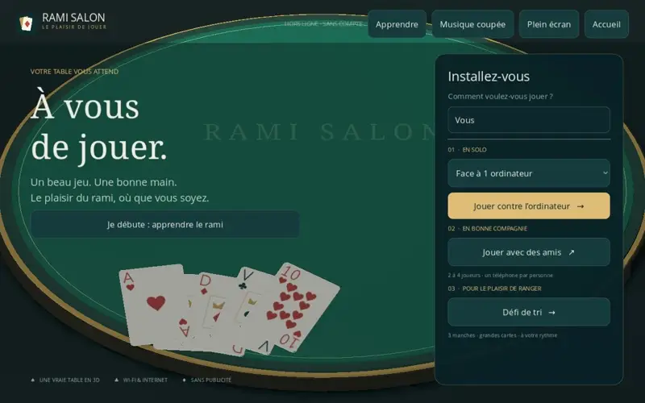
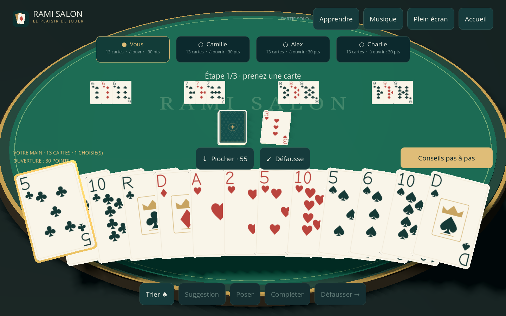

# Rami Salon 3D

Jeu Android de rami en français avec une table en 3D, un mode solo contre 1 à 3 ordinateurs et des salons privés de 2 à 4 joueurs. Projet réalisé avec Godot 4.6.3.

## Kirobo et informations du jeu — version 0.15.0

Le Kirobo est la monnaie virtuelle du jeu. Le portefeuille commence avec 500 Kirobo. Remporter un match solo rapporte 25 Kirobo en facile, 60 en normal ou 120 en difficile. Dans un salon en ligne, les joueurs acceptent la mise choisie par l’hôte et le vainqueur reçoit la cagnotte.

L’intro se lance à l’ouverture. Les textes et les champs de saisie sont agrandis et la fenêtre s’adapte au clavier. **À propos** regroupe la version, le lien vers ce dépôt, les crédits et la [politique de confidentialité](PRIVACY.md).

Pour installer l’APK de test, ouvrez la dernière compilation réussie sur `main` dans [Actions → Android APK](https://github.com/Romuel10/Rami-3D/actions/workflows/android.yml). Dans **Artifacts**, téléchargez l’archive `rami-android-0.15.0-…` et ouvrez `rami-3d.apk` après l’avoir extraite.

## Carte de Madagascar et animations — version 0.13.0

Le profil propose une carte tactile des six provinces et des boutons avec leurs noms. Les contours sont simplifiés à partir des régions Natural Earth 1:10m, regroupées par province. [Données Natural Earth](https://www.naturalearthdata.com/downloads/10m-cultural-vectors/10m-admin-1-states-provinces/)

L’intro montre un éventail de six cartes animé dans l’atelier 3D de Higgsfield. Les éclats de pioche et de défausse ainsi que l’animation de victoire suivent les réglages d’animations et d’économie de batterie du jeu.

## Profils et tournois en ligne — version 0.12.0

Au premier lancement, choisissez un pseudo et une province parmi les six de Madagascar. Le profil local apparaît dans le salon et dans le tableau du tournoi. **Options → Sauvegarder ou restaurer** permet de copier le profil, la partie solo et les statistiques, puis de les restaurer sur un autre appareil.

Dans **Tournois**, créez une compétition privée de Rami ou de Tri. Les quatre joueurs entrent avec le même code. L’hôte lance les deux demi-finales, puis la finale. Le plus petit total gagne chaque duel, avec le nombre de manches remportées pour départager les ex æquo.

## Accueil et Tri entre amis — version 0.11.0

L’accueil présente les trois modes devant la table. Le prénom et les réglages du solo se trouvent dans **Options**. Pendant la partie, la pioche et la défausse ressortent au moment où elles sont disponibles. En ligne, le Rami et le Tri accueillent 2, 3 ou 4 joueurs par salon.

## Salons simplifiés et discussion vocale — version 0.10.0

Rejoindre un ami demande uniquement son code à six chiffres. L’hôte choisit 2, 3 ou 4 joueurs au rami (2 au Tri). Après le match, les joueurs peuvent accepter une revanche dans le même salon. Le bouton micro se maintient pour parler ; il est coupé au départ et en arrière-plan. [Mode d’emploi](#avec-des-amis).

## Cartes classiques et présentation revue — version 0.9.0

- **Cartes illustrées** : vrais portraits de valets, dames et rois, avec les indices classiques J/Q/K. Les 52 faces proviennent du jeu public SVGCards ; deux illustrations de joker servent aux quatre jokers physiques du rami.
- **Le même jeu partout** : parties solo, Wi-Fi, Internet, tutoriels et exercice de rangement utilisent les mêmes illustrations, incluses dans l’APK pour jouer hors connexion.
- **Textes plus simples** : titres en casse normale, boutons courts, une seule famille de caractères pour l’interface et suppression des slogans et flèches décoratives. Les règles gardent leurs explications et exemples.
- **Table plus naturelle** : feutre visible au-dessus de son support, relief et rugosité des matières, dos bleu marine, éclairage ajusté et mains avec doigts distincts.
- Le mode économie conserve 30 images/s sans ombres ni anticrénelage ; le mode normal vise 60 images/s avec anticrénelage 2×. Les performances réelles dépendent du téléphone.

Illustrations : [SVGCards de Saul Spatz](https://github.com/saulspatz/SVGCards), domaine public. [Crédits et adaptations](assets/cards/LICENSE.txt). Les crédits sont accessibles depuis **À propos**. Les salons Supabase sont préconfigurés comme en 0.8.0.

## Mode entre amis hébergé — version 0.8.0

- **Supabase est le serveur Internet du projet** : salons persistants, Rami à 2–4 joueurs et Tri en duel à 6/12 cartes.
- **Adresse déjà configurée** : choisir **Jouer avec des amis → Internet**, créer un salon et transmettre son code à six chiffres.
- Chaque téléphone reçoit uniquement ses cartes. Le serveur vérifie les tours et les actions ; la même place est récupérée après une coupure, pendant 60 secondes.
- Le salon d’attente conserve aussi les places pendant une brève interruption. Un départ volontaire libère la place avant la partie ou compte comme abandon pendant la partie.
- [État du serveur](https://mppunkypxdqyazoojksv.supabase.co/functions/v1/rami-online/health) · [Configuration Supabase](supabase/README.md).

Les essais sur téléphone Android physique restent à effectuer. Les mises à jour publiées dans GitHub Releases nécessitent une signature Android durable ; les APK de test sont disponibles dans les artefacts des compilations.

## Améliorations de la version 0.7.0

- **Tutoriel jouable du Tri** à 6 ou 12 cartes : piocher, repérer ses tris, trier sa main et choisir une défausse gagnante avec le vrai moteur.
- **Regrouper mes tris** : sépare visuellement les groupes dans la main privée. **Trier** et le déplacement manuel reviennent au rangement libre. Aucune carte n’est posée ni révélée.
- **Gestes des adversaires** pour la réflexion, la pioche, la pose et la défausse. Les mouvements sont bornés, s’annulent lors d’un départ et respectent le réglage d’animations.
- **Sons de cartes** : frottement du papier, glissement sur le feutre et petits impacts, avec variations légères et arrêt en arrière-plan.
- **Économie de batterie** dans Confort : limite à 30 images/s et désactive les ombres. Le mode normal est limité à 60 images/s.
- **Internet sur Vercel** : nouveau serveur Node/WebSocket avec stockage Redis partagé. Une adresse HTTPS Vercel est convertie automatiquement et mémorisée ; ensuite, seul le code du salon est demandé. [Déploiement Vercel](vercel/README.md).
- **Essais Android et signature** : un outil vérifie l’APK puis permet un essai sur un téléphone explicitement choisi, sans effacer ses données. Le script de signature propose aussi une vérification des noms des secrets. [Guide appareils](docs/ANDROID-DEVICE-TESTS.md) · [Signature durable](docs/SIGNING.md).

Le serveur Vercel/Redis reste une possibilité d’hébergement indépendante. Le serveur utilisé par défaut depuis la version 0.8.0 est Supabase. Le solo et le Wi-Fi fonctionnent sans connexion à Internet.

## Table et cartes plus réalistes — version 0.6.0

- **Table physique** : feutre texturé, plateau en bois, rebord rembourré, coutures et ombres.
- **Adversaires autour de la table** : places en profondeur, cartes dressées en éventail et mains/manches visibles. Seuls les dos des cartes adverses sont affichés.
- **Cartes en carton** : chants biseautés, papier mat, grain léger, dos gravé et figures illustrées. Les cartes du joueur gardent leur grande taille et leur sélection tactile.
- **Téléchargement corrigé** : sans clé durable configurée, le workflow réussit ses tests et sa compilation, puis propose l’APK dans **Artifacts**. L’absence de clé ne marque plus la compilation en échec. Le résumé de l’exécution contient le lien de téléchargement.

Dans **Actions → Android APK → dernière compilation réussie**, ouvrir **Artifacts**, télécharger l’archive `rami-android-0.6.0-…`, la décompresser et ouvrir `rami-3d.apk` sur le téléphone. Le ZIP ne s’installe pas directement. La publication dans **Releases** nécessite toujours la [clé de signature durable](docs/SIGNING.md).

Les rendus et le picking sont vérifiés en 1440×900 et 2400×1080. Les performances sur les téléphones physiques restent à tester. [Détails du rendu et des vérifications](docs/REALISM-0.6.0.md).

## Tri en duel — version 0.5.0

Le **Tri** est maintenant un vrai duel de cartes, contre l’ordinateur ou un ami sur un autre téléphone. Depuis l’accueil, choisir **Jouer au Tri**, puis **6 cartes** (objectif **2 tris**) ou **12 cartes** (objectif **3 tris**).

- Un tri contient exactement trois cartes de même valeur, avec au maximum deux de la même couleur (♣ ♦ ♥ ♠). Exemple : 7♥ + 7♥ + 7♣. Les suites ne comptent pas.
- Piocher une carte dans la pioche ou sur la défausse, puis défausser une carte. La victoire est vérifiée après cette défausse.
- Tous les tris restent dans la main jusqu’à la victoire. Une carte physique ne compte que dans un seul tri.
- À 12 cartes, trois tris suffisent ; les trois cartes restantes ne doivent former aucune combinaison particulière.
- **Trier ♠** alterne le rangement par couleur et par valeur, y compris pendant le tour adverse. **Mes tris** met les groupes en évidence uniquement sur votre téléphone.
- Le serveur n’envoie jamais la main adverse. Les seuls tris révélés sont ceux du gagnant, après la victoire.

Cette version utilise deux jeux de 52 cartes, **sans jokers**. Le duel fonctionne en Wi-Fi ou sur le serveur Supabase préconfiguré. Les abandons et le délai de reconnexion de 60 secondes s’appliquent aussi au Tri. La reprise solo conserve le mode, les cartes et leur ordre.

L’ancien exercice de classement est désormais nommé **Exercice de rangement** pour le distinguer du Tri. Les sources 0.5.0 sont disponibles ici ; les APK de test sont dans les artefacts du workflow [Android APK](https://github.com/Romuel10/Rami-3D/actions). Une publication avec signature durable attend toujours la [configuration unique de la clé](docs/SIGNING.md).

## Corrections de la version 0.4.0

- **Abandon en cours de match** : quitter volontairement élimine le joueur. À deux, son adversaire gagne immédiatement ; à trois ou quatre, les joueurs restants continuent. Une coupure de connexion laisse 60 secondes pour revenir avant le forfait. Si le téléphone hôte du Wi-Fi quitte, le salon ferme et les joueurs restants gagnent.
- **Salons et reprise réseau** : les places quittées avant le début sont libérées. Le jeton de reprise reste sur le téléphone après fermeture du jeu ; **Retrouver mon salon** rejoint la même place tant que le délai de reconnexion n’est pas dépassé. Le serveur peut sauvegarder ses salons pour survivre à un redémarrage.
- **Suggestions corrigées** pour les deux exemplaires d’une même carte et les différentes répartitions des jokers.
- **Résultat du match corrigé** : le cumul de toutes les manches détermine le gagnant, avec les égalités et les joueurs éliminés affichés correctement.
- **Premier tour guidé** : un exercice jouable apprend à piocher, sélectionner deux suites, ouvrir à 33 points et défausser.
- **Confort** : taille des cartes de 85 à 105 % de leur grande taille actuelle, ordre des boutons adapté aux gauchers et animations désactivables. Les choix sont mémorisés.
- **Signature Android durable** : le workflow exige une clé conservée dans les secrets GitHub pour publier une version. [Configuration à effectuer une fois](docs/SIGNING.md).

Les sources 0.4.0 et les vérifications sont disponibles dans ce dépôt. La publication d’un APK 0.4.0 avec signature durable nécessite la configuration décrite ci-dessus. L’APK 0.3.0 lié plus bas reste la précédente version publiée. [Validation des corrections](docs/CORRECTIONS-0.4.0.md).

## Nouveautés de la version 0.3.0

- **Glisser-déposer** : rangez la main au doigt, faites glisser les cartes sélectionnées sur la table pour les poser, sur une combinaison pour la compléter, ou sur la défausse. Les boutons et les touchers simples restent disponibles.
- **Effets sonores** originaux pour les cartes et la victoire ; activation et volume indépendants de la musique dans **Musique**.
- **Reprise solo automatique** : chaque action et chaque rangement sont sauvegardés. **Reprendre ma partie solo** restitue les cartes, le tour, la difficulté, les scores et l’ordre choisi, même pendant un tour adverse. Une copie précédente permet de récupérer une sauvegarde interrompue.
- **Aide au placement** : les combinaisons que la sélection peut compléter s’éclairent ; le total valide sélectionné apparaît pour l’ouverture à 30 points. Le choix des compléments reste disponible pour les groupes hors de l’écran.
- **Trois difficultés solo** : facile, normal et difficile. L’IA difficile estime les possibilités à partir de sa main et des cartes publiques.
- **Matchs solo de 1, 3 ou 5 manches**, classement cumulé et statistiques personnelles. Les réglages sont dans **Difficulté, manches et statistiques** à l’accueil.
- **Adversaires animés** : mains de dos, pioche et défausse visibles, actions successives et petite célébration en fin de manche.
- **Invitations à copier/coller** : l’hôte choisit **Copier l’invitation** dans le salon. L’ami la colle dans **Jouer avec des amis → Rejoindre avec l’invitation**. L’adresse et le code sont remplis automatiquement.

Une invitation Wi-Fi fonctionne sur le même réseau. Une invitation Internet utilise l’adresse du serveur du salon, Supabase par défaut. L’invitation est un texte à coller dans le jeu, sans ouverture automatique par Android. Les sauvegardes et statistiques solo restent sur l’appareil.

À la fin de chaque manche, les cartes restantes comptent comme pénalités : nombres à leur valeur, figures à 10, as à 11 et jokers à 20. Le plus petit total gagne le match ; les égalités restent ex æquo. Les manches suivantes alternent le premier joueur. Une nouvelle partie remplace la reprise précédente.

Les règles, les sauvegardes, les invitations et les gestes sont vérifiés automatiquement, avec un rendu en 1440×900 et 2400×1080. L’APK reste à essayer sur des téléphones Android physiques. [Détails de validation](docs/MOBILE-GAMEPLAY.md).

## Animations de la version 0.2.1

- **Distribution progressive** depuis la pioche, avec retournement et dos de carte visible.
- **Pioche, pose et défausse en mouvement** : la même carte suit un trajet courbe entre la main et la table.
- **Tri fluide et sélection douce** : les cartes glissent vers leur place ; les touchers rapides peuvent inverser le mouvement sans saut.
- **Transitions discrètes** à l’accueil, dans les fenêtres d’aide et lors des changements de tour.

Les animations réutilisent les cartes visibles et leurs matériaux. Elles s’arrêtent une fois les cartes posées et suivent les mises à jour du jeu solo ou multijoueur. [Détails et vérifications](docs/ANIMATIONS.md).



## Nouveautés de la version 0.2.0

- **Plein écran** : affichage adapté aux téléphones larges, avec un bouton de bascule sur ordinateur et le mode immersif sur Android.
- **Main en grand éventail** : cartes dressées face au joueur, valeurs lisibles et carte sélectionnée relevée, comme une main tenue devant soi.
- **Aide débutant** : douze leçons expliquées, exemples chiffrés et bouton **Conseils pas à pas** adapté à la phase du tour, à la sélection et aux cartes visibles.
- **Musique** : trois compositions instrumentales originales, choix du morceau, volume, coupure et pause en arrière-plan ; préférences mémorisées.
- **Défi de tri** : un jeu séparé en trois manches, avec indices et score, sans limite de temps.

## Télécharger

- [APK 0.6.0 — table et cartes améliorées](https://github.com/Romuel10/Rami-3D/actions/runs/40736372281/artifacts/12836114444) : **compilation réussie**, télécharger le ZIP et en extraire `rami-3d.apk` (connexion GitHub nécessaire).
- [APK 0.5.0 — Tri en duel, version de test](https://github.com/Romuel10/Rami-3D/actions/runs/40729241033/artifacts/12834746569) : télécharger l’archive puis extraire `rami-3d.apk` (connexion GitHub nécessaire).
- [APK 0.4.0 corrigé — artefact de test](https://github.com/Romuel10/Rami-3D/actions/runs/40719725211/artifacts/12830675581) : télécharger l’archive de compilation puis extraire `rami-3d.apk` (connexion GitHub nécessaire). La publication d’une version à signature durable attend la [configuration unique de la clé](docs/SIGNING.md).
- [Installer l’APK Android v0.3.0 — version de test](https://github.com/Romuel10/Rami-3D/releases/download/v0.3.0/rami-3d.apk)
- [Version et fichiers téléchargeables](https://github.com/Romuel10/Rami-3D/releases/tag/v0.3.0)
- [Rapport de vérification](docs/MOBILE-GAMEPLAY.md)



## Installer et jouer

1. Télécharger `rami-3d.apk` depuis la version ci-dessus sur un téléphone Android 7 ou ultérieur (ARM 32/64 bits).
2. Ouvrir l’APK et autoriser l’installation depuis l’application utilisée pour ouvrir ce fichier, si Android le demande.
3. Lancer **Rami Salon 3D**. Le jeu s’affiche en paysage.
4. Choisir **Jouer contre l’ordinateur** pour une partie immédiate sans connexion, ou **Jouer au Tri** pour le duel à 6 ou 12 cartes.

Les anciennes versions de test utilisaient une clé temporaire différente selon les compilations. Le passage à la première signature durable peut encore nécessiter une réinstallation, qui efface les parties et statistiques locales. Les publications suivantes devront conserver cette signature. [Détails](docs/SIGNING.md).

L’APK fourni est signé pour les essais. Ce n’est pas une publication sur Google Play. L’installation et les performances restent à vérifier sur des téléphones physiques ; les essais de cette livraison ont été effectués sous Linux avec Godot et sur des connexions réseau locales distinctes.

## Plein écran, conseils et musique

L’affichage remplit le format de l’écran en paysage. **Plein écran / Fenêtre** permet de basculer sur ordinateur ; Android démarre en mode immersif. Le fond occupe toute la surface et les commandes prennent en compte les zones réservées du téléphone.

**Je débute : jouer mon premier tour** lance un exercice interactif avec de vraies actions. **Lire le guide complet** ouvre douze chapitres : objectif, déroulement d’un tour, couleurs, brelans, suites, ouverture à 30 points, as, jokers, compléments, commandes et fin de manche. Pendant le rami, **Conseils pas à pas** explique quoi faire avec votre main actuelle et donne des exemples précis. Les conseils utilisent uniquement vos cartes et les informations publiques. Le mode débutant ajoute des repères d’étapes ; le guide reste accessible à tous.

**Musique** ouvre le choix entre *Salon acoustique*, *Piano tranquille* et *Escale chill*. Le volume et l’activation sont réglables et mémorisés. La lecture se met en pause lorsque l’application passe en arrière-plan. Les compositions et sons sont originaux ; leur licence CC0 et leur générateur sont dans [assets/music/README.md](assets/music/README.md).

## Exercice de rangement séparé

Depuis l’accueil, choisir **Exercice de rangement**. Touchez une carte, puis une autre pour échanger leurs places. Lisez les emplacements de gauche à droite, puis de haut en bas.

1. **8 cartes** à ranger par valeur croissante, as en premier.
2. **10 cartes** à ranger par couleur, dans l’ordre ♣ ♦ ♥ ♠, puis par valeur.
3. **12 cartes** à ranger par valeur croissante.

**Vérifier** contrôle l’ordre, **Indice** explique une correction possible et **Recommencer** relance une nouvelle série. Les cartes de même valeur peuvent être échangées librement lorsque la couleur n’est pas un critère. Le score retire des points pour les erreurs et les indices, avec un minimum par manche. Le temps est affiché à titre indicatif ; aucune limite ni pénalité de vitesse n’est imposée.

## Avec des amis

Le serveur Supabase est déjà intégré à l’application. Pour le Tri à trois ou quatre, utilisez la version 0.11.0 ou suivante.

1. Pour le Rami, choisir **Jouer avec des amis**. Pour le Tri, choisir **Jouer au Tri**, **6 ou 12 cartes**, puis **Tri avec des amis**. Choisir **En ligne** pour jouer à distance ou **Même Wi-Fi** lorsque les téléphones partagent le réseau local. L’hôte choisit **2, 3 ou 4 joueurs**, **1, 3 ou 5 manches**, puis **Créer un salon**.
2. L’hôte touche **Copier le code** et transmet les six chiffres à ses amis. Les zéros au début du code doivent être conservés.
3. Les amis choisissent le même mode et saisissent les six chiffres. Avant le départ, l’hôte peut ajuster le nombre de places et retirer un invité.
4. Quand tous les joueurs sont présents, l’hôte touche **Commencer la partie**, puis **Manche suivante** entre les manches. Le plus petit total de points gagne le match.
5. À la fin, chaque joueur choisit **Oui, rejouer** ou **Quitter le salon**. Une nouvelle partie commence lorsque tous les joueurs restants sont prêts. Si quelqu’un quitte, les autres restent dans le même salon pour attendre un remplaçant ou ajuster le nombre prévu.

En ligne, maintenez **Maintenir pour parler**, puis relâchez pour couper le micro. Après avoir accordé l’autorisation Android, maintenez de nouveau le bouton. **Voix par joueur** permet de choisir qui entendre. Le micro reste coupé au départ, après une reconnexion et lorsque l’application passe en arrière-plan.

Le mode **Même Wi-Fi** fonctionne sans Internet. Gardez le téléphone qui héberge le salon dans le jeu. [Détails du serveur Supabase](supabase/README.md).

## Règles de cette version

- 108 cartes : deux jeux de 52 cartes et quatre jokers. Treize cartes par joueur.
- À chaque tour : piocher, poser/compléter si possible, puis défausser une carte.
- Brelan/carré : trois/quatre valeurs identiques avec des couleurs différentes.
- Suite : au moins trois cartes consécutives de même couleur. As avant le 2 ou après le roi ; pas de roi-as-2.
- Première pose : au moins 30 points en une ou plusieurs combinaisons. Nombres à leur valeur, figures à 10, as à 1 dans une suite basse et à 11 en suite haute ou en brelan. Le joker prend la valeur de la carte remplacée.
- Au plus la moitié des cartes d’une combinaison peuvent être des jokers.
- Après l’ouverture, on peut compléter les combinaisons de tous les joueurs.
- Il faut garder une carte pour la défausse finale. Le premier à vider sa main gagne la manche.
- La pioche épuisée recycle la défausse en conservant sa carte visible.

Touchez les cartes pour les sélectionner. **Suggestion** sélectionne des combinaisons compatibles avec l’ouverture à 30 points ; **Poser** les joue. **Compléter** propose toutes les combinaisons existantes, même celles qui ne sont plus affichées sur la table lorsque celle-ci contient plus de quatre groupes. **Trier** alterne couleur et valeur.

## Ouvrir et compiler le projet

Ouvrir `project.godot` dans Godot 4.6.3. La scène principale est `main.tscn`. La version utilise le moteur graphique Compatibility pour limiter les exigences matérielles.

Pour compiler l’APK, installer les modèles d’export Android de Godot 4.6.3, Java et le SDK Android (platform-tools et build-tools 36), puis configurer leurs chemins dans les paramètres de l’éditeur Godot. Le profil `Android` est fourni sans chemin local ni secret de signature.

```sh
godot --headless --path . --editor --import --quit
godot --headless --path . --export-debug Android builds/rami-3d.apk
```

Avant une distribution Google Play, préparer une signature de production et un export AAB, puis tester l’application sur les téléphones ciblés.

## Vérifications

```sh
godot --headless --path . --script tests/test_engine.gd
godot --headless --path . --script tests/test_network.gd
godot --headless --path . --script tests/test_game_ui.gd
godot --headless --path . --script tests/test_card_input.gd
godot --headless --path . --script tests/test_update_ui.gd
godot --headless --path . --script tests/test_beginner_coach.gd
godot --headless --path . --script tests/test_sorting.gd
godot --headless --path . --script tests/test_music.gd
godot --headless --path . --script tests/test_animations.gd
godot --headless --path . --script tests/test_mobile_gameplay.gd
godot --headless --path . --script tests/test_solver_forfeit.gd
godot --headless --path . --script tests/test_session_forfeit.gd
godot --headless --path . --script tests/test_forfeit_ui.gd
godot --headless --path . --script tests/test_tutorial_practice.gd
godot --headless --path . --script tests/test_accessibility.gd
godot --headless --path . --script tests/test_tri.gd
godot --headless --path . --script tests/test_tri_ui.gd
godot --headless --path . --script tests/test_tri_lan.gd
godot --headless --path . --script tests/test_tri_tutorial.gd
godot --headless --path . --script tests/test_upgrade_v7.gd
godot --headless --path . --script tests/test_opponent_gestures.gd
godot --headless --path . --script tests/test_sound_effects.gd
GODOT_BIN=/chemin/vers/godot python3 tests/test_internet.py
GODOT_BIN=/chemin/vers/godot python3 tests/test_forfeit_server.py
GODOT_BIN=/chemin/vers/godot python3 tests/test_server_restart.py
GODOT_BIN=/chemin/vers/godot python3 tests/test_tri_network.py
```

Le moteur est testé pour la validité des poses, les jokers, l’ordre des tours, la conservation des cartes et les parties IA complètes. Les tests réseau vérifient les mains privées, les salons distincts, les codes, les droits du créateur, la pause et la reconnexion. Les tests d’intégration `tests/test_game_ui.gd` et `tests/test_update_ui.gd` couvrent une vraie partie et les nouveautés. Le test rendu `tests/test_hand_view.gd`, à lancer avec un affichage graphique, contrôle les grandes cartes et de véritables événements de sélection en 1440×900 et 2400×1080.

## Fichiers principaux

- `scripts/main.gd` : interface et table 3D.
- `scripts/card_3d.gd` : cartes, graphismes vectoriels et sélection tactile.
- `scripts/rami_engine.gd` : règles et IA.
- `scripts/network_manager.gd` : client réseau et hôte Wi-Fi.
- `scripts/tutorial_practice.gd` : premier tour guidé avec les règles réelles.
- `scripts/beginner_coach.gd` : leçons et conseils à partir de la main visible.
- `scripts/music_manager.gd` : pistes, fondu, réglages et pause.
- `scripts/solo_store.gd` : sauvegarde atomique, récupération et statistiques.
- `scripts/sound_effects.gd` : effets sonores synthétisés.
- `scripts/invitation.gd` : invitation avec adresse et code.
- `scripts/sorting_challenge.gd` : défi de tri indépendant.
- `server/server.gd` : serveur Internet indépendant avec salons privés.

Les graphismes des cartes et l’icône sont générés pour ce projet. Les polices Open Sans, Noto Serif et DejaVu Sans sont accompagnées de leurs notices de licence dans `assets/`. Godot est distribué sous [licence MIT](https://godotengine.org/license/).
