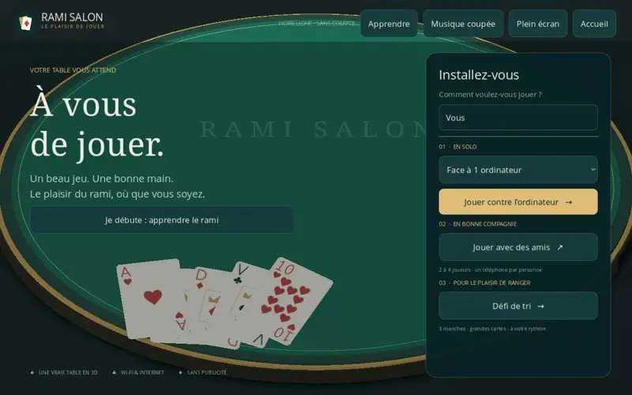
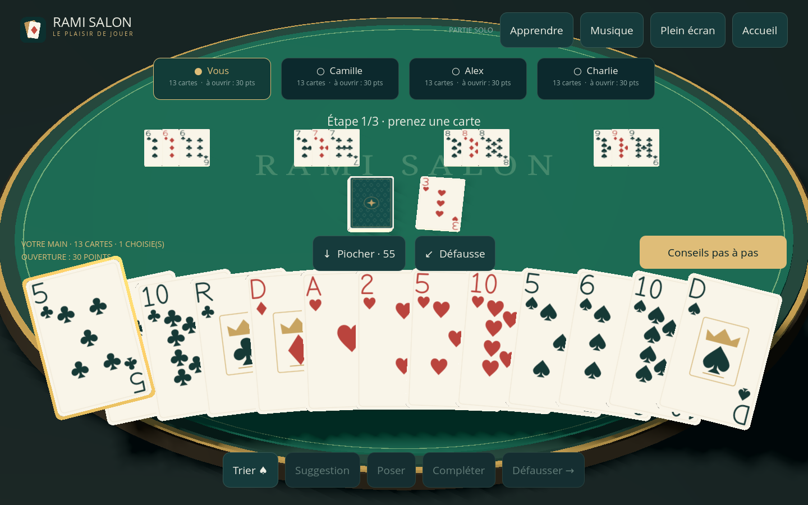

# Rami Salon 3D

Jeu Android de rami en français : une table et des cartes en 3D, un mode solo contre 1 à 3 ordinateurs, et des parties privées à 2–4 joueurs où chacun utilise son téléphone. Projet réalisé avec Godot 4.6.3, sans publicité, compte ni achat intégré.

## Nouveautés de la version 0.3.0

- **Glisser-déposer** : rangez la main au doigt, faites glisser les cartes sélectionnées sur la table pour les poser, sur une combinaison pour la compléter, ou sur la défausse. Les boutons et les touchers simples restent disponibles.
- **Effets sonores** originaux pour les cartes et la victoire ; activation et volume indépendants de la musique dans **Musique**.
- **Reprise solo automatique** : chaque action et chaque rangement sont sauvegardés. **Reprendre ma partie solo** restitue les cartes, le tour, la difficulté, les scores et l’ordre choisi, même pendant un tour adverse. Une copie précédente permet de récupérer une sauvegarde interrompue.
- **Aide au placement** : les combinaisons que la sélection peut compléter s’éclairent ; le total valide sélectionné apparaît pour l’ouverture à 30 points. Le choix des compléments reste disponible pour les groupes hors de l’écran.
- **Trois difficultés solo** : facile, normal et difficile. L’IA difficile estime les possibilités à partir de sa main et des cartes publiques.
- **Matchs solo de 1, 3 ou 5 manches**, classement cumulé et statistiques personnelles. Les réglages sont dans **Difficulté, manches et statistiques** à l’accueil.
- **Adversaires animés** : mains de dos, pioche et défausse visibles, actions successives et petite célébration en fin de manche.
- **Invitations à copier/coller** : l’hôte choisit **Copier l’invitation** dans le salon. L’ami la colle dans **Jouer avec des amis → Rejoindre avec l’invitation**. L’adresse et le code sont remplis automatiquement.

Une invitation Wi-Fi fonctionne sur le même réseau. Une invitation Internet nécessite un serveur WebSocket accessible, comme dans les versions précédentes ; cette livraison n’installe pas de serveur public. L’invitation est un texte à coller dans le jeu, sans ouverture automatique par Android. Les sauvegardes et statistiques solo restent sur l’appareil.

À la fin de chaque manche, les cartes restantes comptent comme pénalités : nombres à leur valeur, figures à 10, as à 11 et jokers à 20. Le plus petit total gagne le match ; les égalités restent ex æquo. Les manches suivantes alternent le premier joueur. Une nouvelle partie remplace la reprise précédente.

Les règles, les sauvegardes, les invitations et les gestes sont vérifiés automatiquement, avec un rendu en 1440×900 et 2400×1080. L’APK reste à essayer sur des téléphones Android physiques. [Détails de validation](docs/MOBILE-GAMEPLAY.md).

## Animations de la version 0.2.1

- **Distribution progressive** depuis la pioche, avec retournement et dos de carte visible.
- **Pioche, pose et défausse en mouvement** : la même carte suit un trajet courbe entre la main et la table.
- **Tri fluide et sélection douce** : les cartes glissent vers leur place ; les touchers rapides peuvent inverser le mouvement sans saut.
- **Transitions discrètes** à l’accueil, dans les fenêtres d’aide et lors des changements de tour.

Les animations réutilisent les cartes visibles et leurs matériaux. Elles s’arrêtent une fois les cartes posées et suivent les mises à jour du jeu solo ou multijoueur. [Détails et vérifications](docs/ANIMATIONS.md).



## Nouveautés de la version 0.2.0

- **Plein écran** : affichage adapté aux téléphones larges, avec un bouton de bascule sur ordinateur et le mode immersif sur Android.
- **Main en grand éventail** : cartes dressées face au joueur, valeurs lisibles et carte sélectionnée relevée, comme une main tenue devant soi.
- **Aide débutant** : douze leçons expliquées, exemples chiffrés et bouton **Conseils pas à pas** adapté à la phase du tour, à la sélection et aux cartes visibles.
- **Musique** : trois compositions instrumentales originales, choix du morceau, volume, coupure et pause en arrière-plan ; préférences mémorisées.
- **Défi de tri** : un jeu séparé en trois manches, avec indices et score, sans limite de temps.

## Télécharger

- [Installer l’APK Android v0.2.0 — environ 59 Mo](https://github.com/Romuel10/Rami-3D/releases/download/v0.2.0/rami-3d.apk)
- [Version et fichiers téléchargeables](https://github.com/Romuel10/Rami-3D/releases/tag/v0.2.0)
- [Rapport de vérification](docs/VERIFICATION.txt)



## Installer et jouer

1. Télécharger `rami-3d.apk` depuis la version ci-dessus sur un téléphone Android 7 ou ultérieur (ARM 32/64 bits).
2. Ouvrir l’APK et autoriser l’installation depuis l’application utilisée pour ouvrir ce fichier, si Android le demande.
3. Lancer **Rami Salon 3D**. Le jeu s’affiche en paysage.
4. Choisir **Jouer contre l’ordinateur** pour une partie immédiate sans connexion, ou **Défi de tri** pour le nouveau jeu de rangement.

Les APK de test GitHub sont signés avec une clé temporaire. Si vous avez installé la version 0.1.0 et qu’Android refuse la mise à jour, désinstallez cette ancienne version, puis installez le nouvel APK.

L’APK fourni est signé pour les essais. Ce n’est pas une publication sur Google Play. L’installation et les performances restent à vérifier sur des téléphones physiques ; les essais de cette livraison ont été effectués sous Linux avec Godot et sur des connexions réseau locales distinctes.

## Plein écran, conseils et musique

L’affichage remplit le format de l’écran en paysage. **Plein écran / Fenêtre** permet de basculer sur ordinateur ; Android démarre en mode immersif. Le fond occupe toute la surface et les commandes prennent en compte les zones réservées du téléphone.

**Apprendre** ouvre douze chapitres : objectif, déroulement d’un tour, couleurs, brelans, suites, ouverture à 30 points, as, jokers, compléments, commandes et fin de manche. Pendant le rami, **Conseils pas à pas** explique quoi faire avec votre main actuelle et donne des exemples précis. Les conseils utilisent uniquement vos cartes et les informations publiques. Le mode débutant ajoute des repères d’étapes ; le guide reste accessible à tous.

**Musique** ouvre le choix entre *Salon acoustique*, *Piano tranquille* et *Escale chill*. Le volume et l’activation sont réglables et mémorisés. La lecture se met en pause lorsque l’application passe en arrière-plan. Les compositions et sons sont originaux ; leur licence CC0 et leur générateur sont dans [assets/music/README.md](assets/music/README.md).

## Défi de tri séparé

Depuis l’accueil, choisir **Défi de tri**. Touchez une carte, puis une autre pour échanger leurs places. Lisez les emplacements de gauche à droite, puis de haut en bas.

1. **8 cartes** à ranger par valeur croissante, as en premier.
2. **10 cartes** à ranger par couleur, dans l’ordre ♣ ♦ ♥ ♠, puis par valeur.
3. **12 cartes** à ranger par valeur croissante.

**Vérifier** contrôle l’ordre, **Indice** explique une correction possible et **Recommencer** relance une nouvelle série. Les cartes de même valeur peuvent être échangées librement lorsque la couleur n’est pas un critère. Le score retire des points pour les erreurs et les indices, avec un minimum par manche. Le temps est affiché à titre indicatif ; aucune limite ni pénalité de vitesse n’est imposée.

## Avec des amis sur le même Wi-Fi

Tous les téléphones doivent être connectés au même Wi-Fi ou au même point d’accès, avec les communications entre appareils autorisées.

- Sur le premier téléphone : **Jouer avec des amis → Même Wi-Fi → Créer un salon**.
- Transmettre l’adresse affichée (par exemple `192.168.1.20:7357`) et le code à six chiffres.
- Sur chaque autre téléphone : **Même Wi-Fi**, saisir cette adresse et ce code, puis **Rejoindre le salon**.
- L’hôte touche **Commencer la partie** quand les joueurs sont présents.

L’hôte garde le jeu ouvert pendant la partie. Les adresses et codes figurant dans ce guide sont des exemples. Si le salon reste inaccessible, vérifier que le réseau Wi-Fi ne bloque pas les communications entre appareils ; les réseaux invités les bloquent souvent.

## Avec des amis par Internet

Le client Android et le serveur Internet sont implémentés et testés ensemble. **Aucun serveur public n’est actuellement hébergé : il faut d’abord installer le serveur fourni sur un ordinateur/VPS accessible par Internet.** Le guide [server/README.md](server/README.md) donne la commande de lancement et la configuration WSS.

Une fois le serveur accessible :

1. Tous les joueurs choisissent **Internet** et saisissent la même adresse `wss://…`.
2. Le premier crée un salon et partage son code.
3. Les autres saisissent le code et rejoignent le salon.
4. Le créateur commence la partie.

Chaque connexion reçoit uniquement sa propre main. Le serveur valide les actions et suspend la partie pendant une coupure réseau. La reconnexion automatique ou le bouton **Se reconnecter** récupère la même place tant que l’application reste ouverte. Un arrêt complet du jeu efface le jeton de reconnexion ; les salons ne survivent pas à un redémarrage du serveur. Pour rejouer en multijoueur, créer un nouveau salon.

## Règles de cette version

- 108 cartes : deux jeux de 52 cartes et quatre jokers. Treize cartes par joueur.
- À chaque tour : piocher, poser/compléter si possible, puis défausser une carte.
- Brelan/carré : trois/quatre valeurs identiques avec des couleurs différentes.
- Suite : au moins trois cartes consécutives de même couleur. As avant le 2 ou après le roi ; pas de roi-as-2.
- Première pose : au moins 30 points en une ou plusieurs combinaisons. Nombres à leur valeur, figures à 10, as à 1 dans une suite basse et à 11 en suite haute ou en brelan. Le joker prend la valeur de la carte remplacée.
- Au plus la moitié des cartes d’une combinaison peuvent être des jokers.
- Après l’ouverture, on peut compléter les combinaisons de tous les joueurs.
- Il faut garder une carte pour la défausse finale. Le premier à vider sa main gagne la manche.
- La pioche épuisée recycle la défausse en conservant sa carte visible.

Touchez les cartes pour les sélectionner. **Suggestion** sélectionne des combinaisons compatibles avec l’ouverture à 30 points ; **Poser** les joue. **Compléter** propose toutes les combinaisons existantes, même celles qui ne sont plus affichées sur la table lorsque celle-ci contient plus de quatre groupes. **Trier** alterne couleur et valeur.

## Ouvrir et compiler le projet

Ouvrir `project.godot` dans Godot 4.6.3. La scène principale est `main.tscn`. La version utilise le moteur graphique Compatibility pour limiter les exigences matérielles.

Pour compiler l’APK, installer les modèles d’export Android de Godot 4.6.3, Java et le SDK Android (platform-tools et build-tools 36), puis configurer leurs chemins dans les paramètres de l’éditeur Godot. Le profil `Android` est fourni sans chemin local ni secret de signature.

```sh
godot --headless --path . --editor --import --quit
godot --headless --path . --export-debug Android builds/rami-3d.apk
```

Avant une distribution Google Play, préparer une signature de production et un export AAB, puis tester l’application sur les téléphones ciblés.

## Vérifications

```sh
godot --headless --path . --script tests/test_engine.gd
godot --headless --path . --script tests/test_network.gd
godot --headless --path . --script tests/test_game_ui.gd
godot --headless --path . --script tests/test_card_input.gd
godot --headless --path . --script tests/test_update_ui.gd
godot --headless --path . --script tests/test_beginner_coach.gd
godot --headless --path . --script tests/test_sorting.gd
godot --headless --path . --script tests/test_music.gd
godot --headless --path . --script tests/test_animations.gd
godot --headless --path . --script tests/test_mobile_gameplay.gd
GODOT_BIN=/chemin/vers/godot python3 tests/test_internet.py
```

Le moteur est testé pour la validité des poses, les jokers, l’ordre des tours, la conservation des cartes et les parties IA complètes. Les tests réseau vérifient les mains privées, les salons distincts, les codes, les droits du créateur, la pause et la reconnexion. Les tests d’intégration `tests/test_game_ui.gd` et `tests/test_update_ui.gd` couvrent une vraie partie et les nouveautés. Le test rendu `tests/test_hand_view.gd`, à lancer avec un affichage graphique, contrôle les grandes cartes et de véritables événements de sélection en 1440×900 et 2400×1080.

## Fichiers principaux

- `scripts/main.gd` : interface et table 3D.
- `scripts/card_3d.gd` : cartes, graphismes vectoriels et sélection tactile.
- `scripts/rami_engine.gd` : règles et IA.
- `scripts/network_manager.gd` : client réseau et hôte Wi-Fi.
- `scripts/beginner_coach.gd` : leçons et conseils à partir de la main visible.
- `scripts/music_manager.gd` : pistes, fondu, réglages et pause.
- `scripts/solo_store.gd` : sauvegarde atomique, récupération et statistiques.
- `scripts/sound_effects.gd` : effets sonores synthétisés.
- `scripts/invitation.gd` : invitation avec adresse et code.
- `scripts/sorting_challenge.gd` : défi de tri indépendant.
- `server/server.gd` : serveur Internet indépendant avec salons privés.

Les graphismes des cartes et l’icône sont générés pour ce projet. Les polices Open Sans, Noto Serif et DejaVu Sans sont accompagnées de leurs notices de licence dans `assets/`. Godot est distribué sous [licence MIT](https://godotengine.org/license/).
