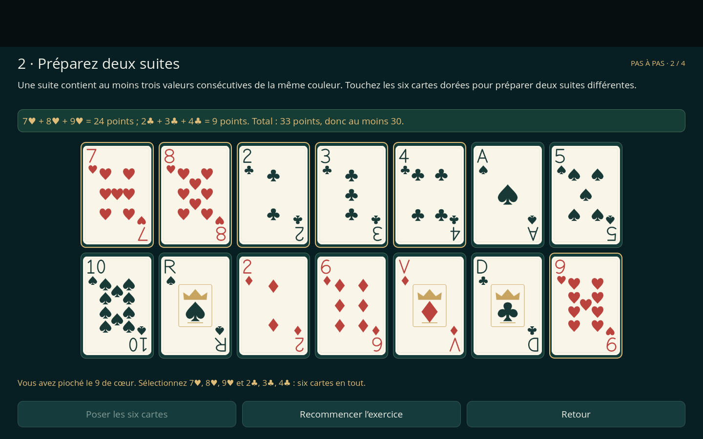
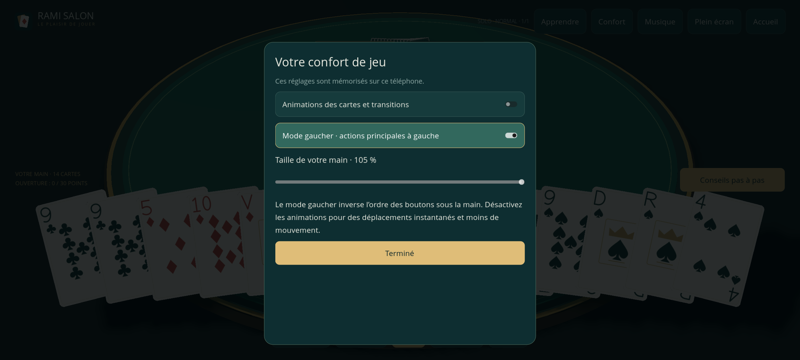

# Rami Salon 3D 0.4.0 — corrections vérifiées

## Comportement en cas de départ

Un départ volontaire envoyé pendant une partie est un abandon définitif. En duel, l’adversaire gagne le match, même si plusieurs manches étaient prévues. À trois ou quatre joueurs sur un serveur disponible, l’absent est éliminé et les autres continuent ; sa place est sautée sans déplacer ni dupliquer de carte. Le dernier joueur actif gagne. Si l’hôte du Wi-Fi quitte, son téléphone ne peut plus servir la partie : les joueurs restants sont déclarés gagnants avant la fermeture du salon.

Une perte de transport est distincte d’un abandon transmis : la table se met en pause pendant 60 secondes pour laisser le téléphone revenir. Au-delà, l’absence devient un forfait. Le jeton de reprise est enregistré sur le téléphone, sans être inclus dans une invitation. Le serveur dispose d’une sauvegarde optionnelle ; après redémarrage, les téléphones ont un nouveau délai de 60 secondes pour revenir.

En solo, **Sauvegarder et revenir à l’accueil** conserve la partie. **Abandonner la partie** enregistre une défaite définitive et annule les actions d’IA en attente.

## Corrections des règles et des résultats

Le solveur énumère les sous-ensembles de cartes physiques de la main, y compris les deux exemplaires d’une même valeur/couleur et les différents jokers. Il peut trouver plusieurs groupes compatibles qui utilisent des exemplaires différents. La recherche est bornée par les 14 cartes d’une main après pioche.

Le résultat du match utilise le cumul des pénalités sur toutes les manches. Le gagnant de la dernière manche ne remplace plus le gagnant au cumul. Les égalités partagent la victoire, les joueurs éliminés sont exclus du classement actif et le résultat reste identique après sérialisation JSON.

Les départs avant le début libèrent les places du salon ; les indices et le rôle de créateur sont réattribués aux joueurs présents.

## Apprentissage et confort

Le premier tour guidé utilise le vrai moteur et les 108 cartes : piocher un 9 de cœur, préparer 7♥–8♥–9♥ et 2♣–3♣–4♣, ouvrir à 33 points puis choisir une défausse. Les erreurs sont expliquées sans jouer à la place du débutant. Le guide complet et les conseils en partie restent disponibles.

Les préférences **Confort** mémorisent une taille de carte de 85 à 105 % de la grande main actuelle, l’ordre des boutons pour les gauchers et l’activation des animations. La désactivation arrête aussi les déplacements de cartes déjà en cours.

## Vérifications reproductibles

Les suites ajoutées couvrent les cas suivants :

| Suite | Vérification |
| --- | --- |
| `test_solver_forfeit.gd` | Doubles exemplaires, jokers, abandons, tours sautés, sauvegarde JSON et conservation des 108 cartes |
| `test_session_forfeit.gd` | Vraies connexions Wi-Fi, salons, forfaits, reprise dans un nouveau client et départ de l’hôte |
| `test_forfeit_server.py` | Serveur dédié, abandon volontaire, délai d’absence, reprise de la même main et élimination à 3/4 joueurs |
| `test_server_restart.py` | Arrêt/redémarrage réel du serveur, cartes privées, résultat terminal et copie de secours corrompue |
| `test_forfeit_ui.gd` | Résultat cumulé, égalités, classement actif, abandon solo enregistré et réponse réseau tardive |
| `test_tutorial_practice.gd` | Actions du premier tour et rendu en 1440×900 et 2400×1080 |
| `test_accessibility.gd` | Réglages réels, persistance, ordre des boutons, mouvement désactivé et 14 cartes aux tailles extrêmes |

Le workflow conserve aussi les suites des versions précédentes : règles, parties IA complètes, musique, tri, guide, animations, gestes et rendu de la main. Chaque suite utilisateur doit être lancée avec un répertoire `XDG_DATA_HOME` isolé, comme indiqué dans le workflow.

Le rapport [VERIFICATION.txt](VERIFICATION.txt) indique les résultats. [android-build-info.txt](android-build-info.txt) et [SHA256SUMS](SHA256SUMS) identifient la compilation locale ; les artefacts Actions contiennent leur propre rapport et leurs propres empreintes.

## Livraison Android et serveur

La version vise Android 7 ou ultérieur en ARM32/ARM64. Une clé Android durable doit être configurée une fois avant la publication GitHub de l’APK ; [SIGNING.md](SIGNING.md) fournit le script et les étapes. Un APK d’essai peut être téléchargé dans les artefacts Actions même en l’absence de cette configuration. Les anciennes signatures temporaires ne peuvent pas être restaurées par ce changement.

Aucun téléphone Android physique n’a été utilisé dans cet environnement. Restent à essayer sur les appareils ciblés : installation, arrière-plan réel, appel entrant, audio, gestes et performances. Le serveur Internet n’est pas déployé automatiquement ; il reste à le raccorder à l’hébergement choisi et à son adresse WSS.
